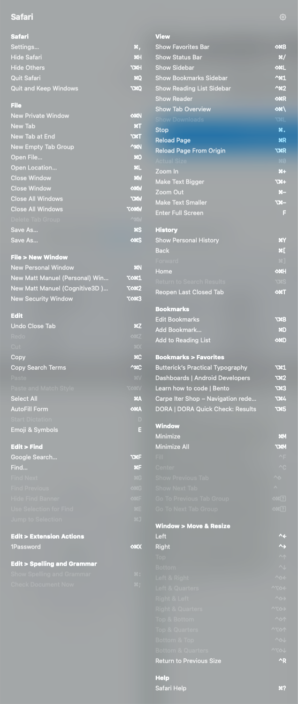

<!-- Generated by scripts/sync-cribsheet-readme.sh in the mattmanuel.ca repo.
     The body is shared with https://mattmanuel.com/cribsheet/ ; edit
     docs/cribsheet.md there. The Get it / Support / License tail is
     .github/readme-tail.md in this repo. Re-run the sync after editing. -->

# Cribsheet

## Hold ⌘. See every shortcut

Early days · free · not yet released

Cribsheet is a tiny background utility for macOS. Press and hold Command
for a moment, and a floating overlay shows every keyboard shortcut in
whatever app is in front of you — grouped by menu, exactly as that app
defines them. Let go, and it's gone.

*Cribsheet reading Safari's own menu bar. Every app looks like this.*

### Why it exists

Cribsheet has no shortcut database to fall in and out of date. It reads
the frontmost app's menu bar live, the moment you ask, so it's always
correct — including any shortcut you've customised yourself. It's a
spiritual successor to *CheatSheet*, a small utility that did the same
thing until its developer moved on; Cribsheet exists because I missed it.

### Built to see nothing else

Cribsheet reads menu titles and their shortcuts. Nothing more. It makes
no network calls of any kind — no telemetry, no analytics, no update
check, nothing sent anywhere, ever. See the
[privacy policy](https://mattmanuel.com/privacy/) — it's short.

### Requirements

macOS 14 or later. Free. About 2&nbsp;MB.

## Get it

A signed, notarised build is coming here very soon:

- Direct download from this repo's [Releases](https://github.com/matt-the-ogre/cribsheet-releases/releases)
- Homebrew: `brew install --cask matt-the-ogre/tap/cribsheet` (goes live with the first release)

Until then, watch this repo, or email cribsheet [at] mattmanuel [dot] com to get notified when it ships.

More at [mattmanuel.com/cribsheet](https://mattmanuel.com/cribsheet/).

## Support

Cribsheet is free. If it is useful to you, you can [sponsor me on GitHub](https://github.com/sponsors/matt-the-ogre).

## License

Free to download and use; not open source. Copyright 2026 Matthew Alexander Manuel. See [LICENSE.md](LICENSE.md).
